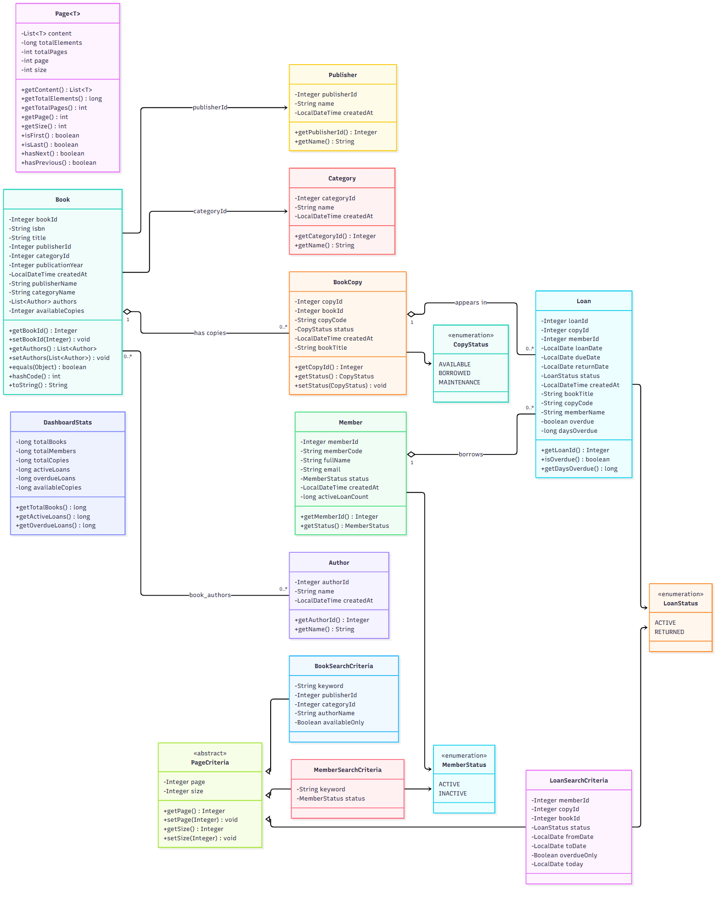
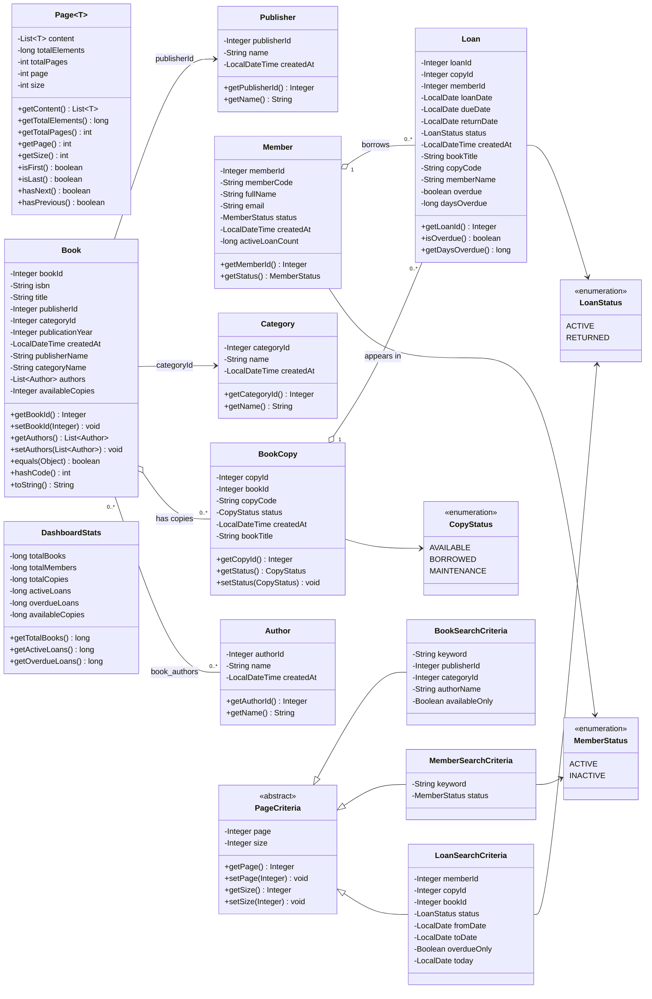
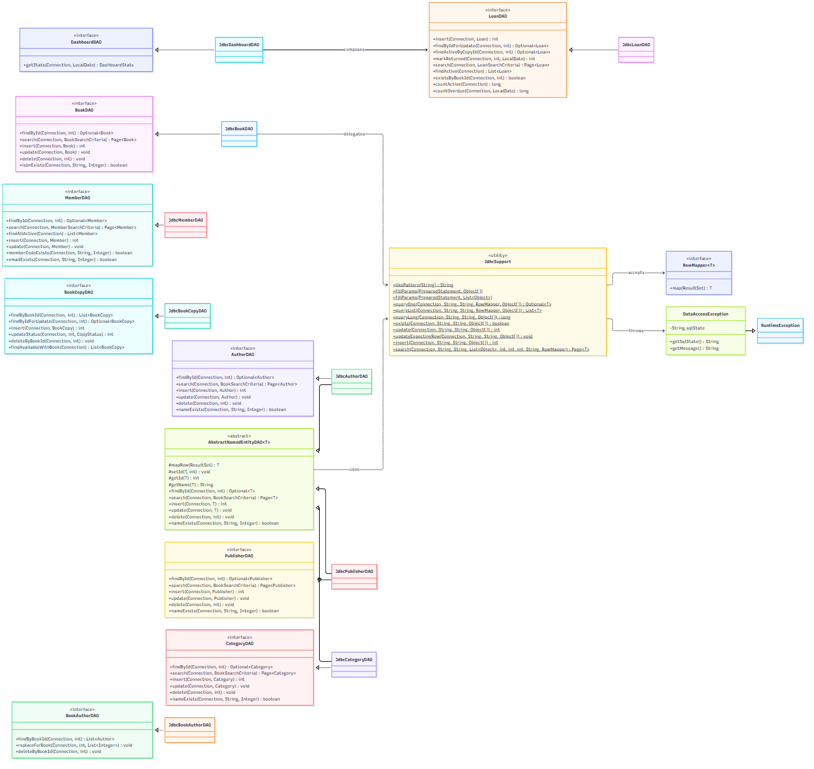
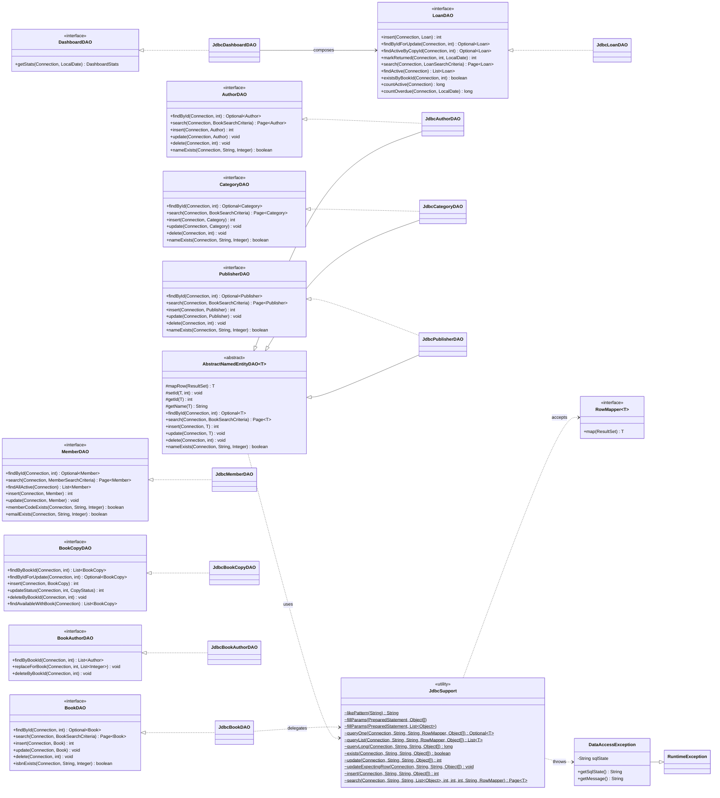

# Class Design — Library Management System

> **Report scope:** Sections III–VI of the project report (Class Design, 3-Tier Model, Package Design, Interface Design).
>
> **Source basis:** current `src/main/java` tree — 39 production Java files: 9 model classes, 4 criteria classes, 3 enums, 9 DAO interfaces, 9 JDBC DAOs, 2 shared JDBC support classes, 2 config classes, and 1 exception class. The class diagram and tables below describe implemented code only. Controller, Service, filter, and build classes are Person 2 scope and are marked as **not implemented** where relevant.
>
> **Related evidence:** `docs/java-concepts-mapping.md`, `docs/phase1-plan.md`, `docs/test-suite-report.md`.

---

## III. CLASS DESIGN

### 1. Classes

#### Figure 2. Class Diagram of Project

The diagram is split into two parts for readability. Figure 2a shows the domain model; Figure 2b shows the DAO/persistence layer. Together they form the project class diagram.

**Figure 2a — Domain model and search criteria**

[](diagrams/figure-2a-domain-model.png)

[Open PNG](diagrams/figure-2a-domain-model.png) · [Mermaid source](diagrams/figure-2a-domain-model.mmd)

<details>
<summary>Mermaid source</summary>



</details>

**Figure 2b — DAO interfaces, JDBC implementations, and shared support**

[](diagrams/figure-2b-dao-layer.png)

[Open PNG](diagrams/figure-2b-dao-layer.png) · [Mermaid source](diagrams/figure-2b-dao-layer.mmd)

<details>
<summary>Mermaid source</summary>



</details>

Legend: `+` public, `-` private, `#` protected, `~` package-private, `$` static. `..>` is a dependency; `<|--` is class inheritance; `<|..` is interface realization; `-->` is an association; `o--` is aggregation.

`Page<T>` is a DAO return wrapper rather than a domain association, so Figure 2a keeps it as a standalone generic class. Figure 2b shows one representative `JdbcBookDAO → JdbcSupport` delegation arrow and the inherited use through `AbstractNamedEntityDAO<T>`; the other direct JDBC DAOs call the same static helpers, and those repetitive arrows are omitted for readability.

#### Table 2. Details of Classes

The table covers the model, criteria, enum, configuration, exception, and JDBC implementation classes, including the two abstract classes that are summarized again in Table 3. DAO interfaces are detailed separately in Section VI.

| No | Class | Modifiers and visibility | Instance variables | Main methods | Description |
|---:|---|---|---|---|---|
| 1 | `Book` | `public class`; all fields `private`; two constructors | `bookId`, `isbn`, `title`, `publisherId`, `categoryId`, `publicationYear`, `createdAt`; display projections `publisherName`, `categoryName`, `authors`, `availableCopies` | Public getters/setters; `equals`, `hashCode`, `toString` (`@Override`) | Catalog entity. `private` fields enforce encapsulation; write operations use only persisted columns. `publisherName`, `categoryName`, and `availableCopies` are populated by DAO joins; `authors` is loaded through `BookAuthorDAO`. |
| 2 | `BookCopy` | `public class`; fields `private`; two constructors | `copyId`, `bookId`, `copyCode`, `CopyStatus status`, `createdAt`; display field `bookTitle` | Public getters/setters; `equals`, `hashCode`, `toString` | One physical copy of a book. `status` is type-safe through `CopyStatus`. `bookTitle` is a read-only display projection from a join. |
| 3 | `Loan` | `public class`; fields `private`; two constructors | `loanId`, `copyId`, `memberId`, `loanDate`, `dueDate`, `returnDate`, `LoanStatus status`, `createdAt`; display fields `bookTitle`, `copyCode`, `memberName`; derived fields `overdue`, `daysOverdue` | Public getters/setters; `isOverdue()`, `getDaysOverdue()`; `equals`, `hashCode`, `toString` | Borrowing record. `overdue` and `daysOverdue` have no database column; the future Service layer must compute them. `bookTitle`, `copyCode`, and `memberName` come from joined reads. |
| 4 | `Member` | `public class`; fields `private`; two constructors | `memberId`, `memberCode`, `fullName`, `email`, `MemberStatus status`, `createdAt`; display field `activeLoanCount` | Public getters/setters; `equals`, `hashCode`, `toString` | Library member. `activeLoanCount` counts loans whose `return_date` is `null`; it is populated by member list queries. |
| 5 | `Author` | `public class`; fields `private`; two constructors | `authorId`, `name`, `createdAt` | Public getters/setters; `equals`, `hashCode`, `toString` | Author reference entity. `equals`/`hashCode` compare `authorId`, which lets authors participate in sets and maps. |
| 6 | `Category` | `public class`; fields `private`; two constructors | `categoryId`, `name`, `createdAt` | Public getters/setters; `equals`, `hashCode`, `toString` | Book category reference entity. Name uniqueness is case-insensitive at the database and DAO level. |
| 7 | `Publisher` | `public class`; fields `private`; two constructors | `publisherId`, `name`, `createdAt` | Public getters/setters; `equals`, `hashCode`, `toString` | Publisher reference entity. |
| 8 | `Page<T>` | `public class`; generic; all fields `private final` | `List<T> content`, `long totalElements`, `int totalPages`, `int page`, `int size` | `getContent`, `getTotalElements`, `getTotalPages`, `getPage`, `getSize`, `isFirst`, `isLast`, `hasNext`, `hasPrevious`; `equals`, `hashCode`, `toString` | Reusable pagination wrapper for books, members, loans, and reference data. The constructor stores a defensive unmodifiable copy of the content list. `final` fields make page metadata immutable after construction. |
| 9 | `DashboardStats` | `public class`; fields `private`; two constructors | Six `long` metrics: `totalBooks`, `totalMembers`, `totalCopies`, `activeLoans`, `overdueLoans`, `availableCopies` | Public getters/setters; `toString` | Read-only dashboard result object. Primitive `long` avoids `null` for counts. |
| 10 | `PageCriteria` | `public abstract class`; fields `private` | `Integer page`, `Integer size` | Concrete `getPage`, `setPage`, `getSize`, `setSize` with clamping | Shared pagination state for all search criteria. `abstract` prevents direct instantiation; subclasses add only their own filters. Getters clamp `page >= 0`, `1 <= size <= 100`. |
| 11 | `BookSearchCriteria` | `public class extends PageCriteria`; fields `private` | `keyword`, `publisherId`, `categoryId`, `authorName`, `availableOnly` | Public getters/setters; `toString` (`@Override`) | Book search filters. The DAO applies every non-null criterion and combines keyword search with `unaccent`/`ILIKE`. |
| 12 | `MemberSearchCriteria` | `public class extends PageCriteria`; fields `private` | `keyword`, `MemberStatus status` | Public getters/setters; `toString` | Member search filters. `keyword` matches full name or member code. |
| 13 | `LoanSearchCriteria` | `public class extends PageCriteria`; fields `private` | `memberId`, `copyId`, `bookId`, `LoanStatus status`, `fromDate`, `toDate`, `overdueOnly`, `today` | Public getters/setters; `toString` | Loan history/overdue filters. `today` is caller-supplied so date-sensitive tests are deterministic; it defaults to `LocalDate.now()`. |
| 14 | `CopyStatus` | `public enum`; constants implicitly `public static final` | `AVAILABLE`, `BORROWED`, `MAINTENANCE` | Implicit `values()`, `valueOf()`, `name()` | Type-safe copy status mirroring the database `CHECK` constraint. Enums cannot be extended. |
| 15 | `LoanStatus` | `public enum` | `ACTIVE`, `RETURNED` | Implicit enum methods | Stored loan status. Overdue is derived from dates and is **not** an enum value because it has no database column. |
| 16 | `MemberStatus` | `public enum` | `ACTIVE`, `INACTIVE` | Implicit enum methods | Member status mirroring the database `CHECK` constraint. |
| 17 | `DataAccessException` | `public class extends RuntimeException`; field `private final String sqlState`; `serialVersionUID` `private static final long` | `sqlState` | Four overloaded constructors; `getSqlState()`; `getMessage()` (`@Override`) | Wraps `SQLException` so DAO interfaces do not declare checked exceptions. `RuntimeException` keeps the DAO contract simple; `getMessage()` appends `SQLState` for debugging. |
| 18 | `DatabaseConnection` | `public final class`; private constructor; constants `private static final` | No instance fields | `public static Connection getConnection()`; `private static String loadExternalPassword()` | Connection factory. `final` + private constructor prevent instantiation/inheritance. Reads `DB_URL`, `DB_USER`, `DB_PASSWORD`, and optional `DB_CONFIG`. The caller owns closing and transaction boundaries. |
| 19 | `AppConfig` | `public final class`; private constructor; constants `public static final` | No instance fields | No instance methods; constants only | Central place for SQLState values, loan period (14 days), and pagination limits (10/100/zero-based). `final` prevents subclassing; `static final` values are immutable. |
| 20 | `AbstractNamedEntityDAO<T>` | package-private `abstract class`; generic; metadata fields `private final`; constructor package-private | `table`, `idColumn`, `entityLabel`, `caseInsensitiveName` | Concrete `findById`, `search`, `insert`, `update`, `delete`, `nameExists`; `protected abstract` `mapRow`, `setId`, `getId`, `getName` | Template-method base for the three reference tables (`authors`, `categories`, `publishers`). Subclasses supply only table metadata and row mapping; CRUD/search SQL is written once. Package-private because it is an implementation detail of `com.library.dao.jdbc`. |
| 21 | `JdbcSupport` | package-private `final class`; private constructor; all methods `static` | No instance fields; nested `RowMapper<T>` interface | `likePattern`, two `fillParams` overloads, `queryOne`, `queryList`, `queryLong`, `exists`, `update`, `updateExpectingRow`, `insert`, `search` | Shared JDBC mechanics: parameter binding, LIKE escaping, reads, counts, generated keys, affected-row checks, and count+data pagination. Does not own transactions and never closes the caller's connection. Package-private so the service layer cannot bypass the DAO interfaces. |
| 22 | `JdbcBookDAO` | `public class implements BookDAO`; SQL strings `private static final` | No mutable instance fields | `findById`, `search`, `insert`, `update`, `delete`, `isbnExists`; private `appendSearchFilters`, `trimIsbn`, `mapBook` | Handwritten JDBC implementation for books. Reads join publishers/categories and compute available copies; search supports keyword, publisher, category, author name, and availability. |
| 23 | `JdbcMemberDAO` | `public class implements MemberDAO`; SQL strings `private static final` | No mutable instance fields | `findById`, `search`, `findAllActive`, `insert`, `update`, `memberCodeExists`, `emailExists`; private `appendFilters`, `normalizeEmail`, `statusName`, `mapMember` | Member persistence. Email uniqueness is case-insensitive; blank email is normalized to `NULL`; list reads include `activeLoanCount`. |
| 24 | `JdbcLoanDAO` | `public class implements LoanDAO`; SQL strings `private static final` | No mutable instance fields | `insert`, `findByIdForUpdate`, `findActiveByCopyId`, `markReturned`, `search`, `findActive`, `existsByBookId`, `countActive`, `countOverdue`; private `appendFilters`, `statusName`, `mapLoan`, `mapLoanWithDisplay` | Loan persistence. Detail/history reads join copies, books, and members; locking reads use `FOR UPDATE` on the base `loans` table so PostgreSQL accepts the lock. |
| 25 | `JdbcBookCopyDAO` | `public class implements BookCopyDAO`; SQL strings `private static final` | No mutable instance fields | `findByBookId`, `findByIdForUpdate`, `insert`, `updateStatus`, `deleteByBookId`, `findAvailableWithBook`; private `mapBookCopy`, `mapAvailableCopy` | Copy persistence. `findByIdForUpdate` locks a copy for borrow/return; `findAvailableWithBook` joins the book title for the borrow screen. |
| 26 | `JdbcBookAuthorDAO` | `public class implements BookAuthorDAO`; SQL strings `private static final` | No mutable instance fields | `findByBookId`, `replaceForBook`, `deleteByBookId`; private `mapAuthor` | Manages the `book_authors` many-to-many table. `replaceForBook` deduplicates IDs with `LinkedHashSet`, deletes old links, and batch-inserts new links inside the caller's transaction. |
| 27 | `JdbcDashboardDAO` | `public class implements DashboardDAO`; field `private final LoanDAO loanDao`; two constructors | `loanDao` | `getStats(Connection, LocalDate)` | Dashboard metrics. Composes a `LoanDAO` so active/overdue predicates exist once; the package-private constructor allows same-package test substitution. |
| 28 | `JdbcAuthorDAO` | `public class extends AbstractNamedEntityDAO<Author> implements AuthorDAO`; no instance fields | No instance fields | Public no-arg constructor; `protected` overrides `mapRow`, `setId`, `getId`, `getName` | Author DAO. Inherits CRUD/search/nameExists from the abstract base; supplies table metadata and mapping only. |
| 29 | `JdbcCategoryDAO` | `public class extends AbstractNamedEntityDAO<Category> implements CategoryDAO`; no instance fields | No instance fields | Public no-arg constructor; `protected` overrides `mapRow`, `setId`, `getId`, `getName` | Category DAO. Passes `caseInsensitiveName = true`, matching the unique lower-name index. |
| 30 | `JdbcPublisherDAO` | `public class extends AbstractNamedEntityDAO<Publisher> implements PublisherDAO`; no instance fields | No instance fields | Public no-arg constructor; `protected` overrides `mapRow`, `setId`, `getId`, `getName` | Publisher DAO. Inherits the shared reference-table behavior. |

#### Table 3. Details of Abstract Classes

| No | Abstract Class | Abstract methods | Concrete methods | Description |
|---:|---|---|---|---|
| 1 | `AbstractNamedEntityDAO<T>` | `protected T mapRow(ResultSet)`; `protected void setId(T, int)`; `protected int getId(T)`; `protected String getName(T)` | `public Optional<T> findById(Connection, int)`; `public Page<T> search(Connection, BookSearchCriteria)`; `public int insert(Connection, T)`; `public void update(Connection, T)`; `public void delete(Connection, int)`; `public boolean nameExists(Connection, String, Integer)` | Generic template-method base for `authors`, `categories`, and `publishers`. The concrete CRUD/search algorithms are written once; subclasses supply only the four mapping/access hooks. Package-private; extended by `JdbcAuthorDAO`, `JdbcCategoryDAO`, and `JdbcPublisherDAO`. |
| 2 | `PageCriteria` | None. It is declared `abstract` to prevent direct instantiation, not to force a method implementation. | `public Integer getPage()`; `public void setPage(Integer)`; `public Integer getSize()`; `public void setSize(Integer)` | Shared pagination state for `BookSearchCriteria`, `MemberSearchCriteria`, and `LoanSearchCriteria`. The concrete getters/setters clamp the page index and page size so every subclass inherits the same bounds. |

`RowMapper<T>` is a one-method **interface**, not an abstract class; it is described in Section VI. `DataAccessException` is a concrete class and is therefore listed in Table 2, not here.

**Visibility and modifier summary**

| Modifier | Where used | Why |
|---|---|---|
| `private` fields | All model classes, criteria, `Page`, `AbstractNamedEntityDAO` metadata, `JdbcDashboardDAO.loanDao` | Encapsulation: callers use getters/setters or constructor arguments, so invariants stay inside the class. |
| `public` methods | Model accessors, DAO interface methods, `DatabaseConnection.getConnection()` | Cross-package API used by other layers. |
| `protected` methods | `AbstractNamedEntityDAO.mapRow/setId/getId/getName` | Visible to subclasses only; they are implementation hooks, not public API. |
| package-private classes | `AbstractNamedEntityDAO`, `JdbcSupport` | Hidden inside `com.library.dao.jdbc`; service/controller code must depend on `com.library.dao` interfaces. |
| package-private methods/constructors | `JdbcSupport` static helpers, `AbstractNamedEntityDAO` constructor, `JdbcDashboardDAO(LoanDAO)` | Visible only inside `com.library.dao.jdbc`; keeps helper mechanics and the test seam out of the public API. |
| `final` classes | `AppConfig`, `DatabaseConnection`, `JdbcSupport` | Utility classes are not designed for inheritance. |
| `final` fields | `Page` metadata, `DataAccessException.sqlState`, DAO metadata | Immutable after construction; safe to share and reason about. |
| `static` / `static final` | `JdbcSupport` methods, `DatabaseConnection.getConnection`, `AppConfig` constants, SQL strings | Stateless behavior and shared constants; SQL text is compiled once per class. |
| `abstract` | `PageCriteria`, `AbstractNamedEntityDAO` | Prevent direct instantiation and force subclasses to supply the missing behavior. |

### 2. Some OOP Techniques

#### 2.1 Overloading

Overloading means several methods or constructors share a name but differ in parameter list. The project uses overloading in three places.

**(a) Entity constructors — no-arg constructor plus full constructor**

```java
public class Book {
    public Book() {
    }

    public Book(Integer bookId, String isbn, String title,
                Integer publisherId, Integer categoryId, Integer publicationYear) {
        this.bookId = bookId;
        this.isbn = isbn;
        this.title = title;
        this.publisherId = publisherId;
        this.categoryId = categoryId;
        this.publicationYear = publicationYear;
    }
}
```

`Book()`, `Loan()`, `Member()`, `BookCopy()`, `Author()`, `Category()`, `Publisher()`, and `DashboardStats()` support JavaBean-style creation by JDBC mappers; the full constructor is convenient for tests and future service code.

**(b) `JdbcSupport.fillParams` — varargs overload and `List` overload**

```java
static void fillParams(PreparedStatement ps, Object... params) throws SQLException {
    for (int i = 0; i < params.length; i++) {
        ps.setObject(i + 1, params[i]);
    }
}

static void fillParams(PreparedStatement ps, List<Object> params) throws SQLException {
    for (int i = 0; i < params.size(); i++) {
        ps.setObject(i + 1, params.get(i));
    }
}
```

The varargs form is used by fixed-parameter queries (`queryOne`, `queryList`, `insert`, `update`); the `List<Object>` form is used by dynamic search queries, where the number of filter parameters is not known at compile time. The compiler selects the correct overload from the argument type.

**(c) Constructors in support/exception classes**

```java
public DataAccessException(String message, SQLException cause) { ... }
public DataAccessException(String message, String sqlState, Throwable cause) { ... }
public DataAccessException(String message, Throwable cause) { ... }
public DataAccessException(String message) { ... }
```

`JdbcDashboardDAO` also has two constructors: a public no-arg constructor that creates `new JdbcLoanDAO()` and a package-private constructor that accepts a `LoanDAO` for tests. `DashboardStats` has a no-arg constructor and a six-argument constructor. Overloading keeps call sites readable while preserving a single class name.

#### 2.2 Overriding

Overriding means a subclass or implementation class replaces an inherited method with its own behavior. The project uses overriding for interface methods, abstract hooks, and `Object` methods.

**(a) DAO interface implementation**

```java
public interface BookDAO {
    Optional<Book> findById(Connection c, int bookId);
    Page<Book> search(Connection c, BookSearchCriteria criteria);
    int insert(Connection c, Book book);
    void update(Connection c, Book book);
    void delete(Connection c, int bookId);
    boolean isbnExists(Connection c, String isbn, Integer excludeBookId);
}

public class JdbcBookDAO implements BookDAO {
    @Override
    public Optional<Book> findById(Connection c, int bookId) {
        return JdbcSupport.queryOne(c, FIND_BY_ID,
                "Failed to find book by id: " + bookId, rs -> mapBook(rs), bookId);
    }

    @Override
    public int insert(Connection c, Book book) {
        String isbn = trimIsbn(book.getIsbn());
        int id = JdbcSupport.insert(c, INSERT, "Failed to insert book: " + isbn,
                isbn, book.getTitle(), book.getPublisherId(), book.getCategoryId(),
                book.getPublicationYear());
        book.setBookId(id);
        return 1;
    }
}
```

The six direct implementation classes use `@Override` on every DAO method they implement. The three reference DAOs inherit the `findById`, `search`, `insert`, `update`, `delete`, and `nameExists` implementations from `AbstractNamedEntityDAO` and use `@Override` on the protected abstract hooks they fill in. The caller sees only `BookDAO`; the JVM dispatches to `JdbcBookDAO` at runtime.

**(b) Abstract hook overriding in the reference DAOs**

```java
public class JdbcAuthorDAO extends AbstractNamedEntityDAO<Author> implements AuthorDAO {

    @Override
    protected Author mapRow(ResultSet rs) throws SQLException {
        Author author = new Author();
        author.setAuthorId(rs.getInt("author_id"));
        author.setName(rs.getString("name"));
        author.setCreatedAt(rs.getObject("created_at", LocalDateTime.class));
        return author;
    }

    @Override
    protected void setId(Author author, int id) {
        author.setAuthorId(id);
    }

    @Override
    protected int getId(Author author) {
        return author.getAuthorId();
    }

    @Override
    protected String getName(Author author) {
        return author.getName();
    }
}
```

`AbstractNamedEntityDAO.findById` calls `mapRow(rs)`, `insert` calls `getName(...)` and `setId(...)`, `update` calls `getName(...)` and `getId(...)`, and `delete` uses the supplied id. Because these methods are abstract, the base class can run one generic algorithm while the subclass decides how to read/write the concrete entity. This is the **template method** pattern.

**(c) Overriding `Object` methods**

```java
@Override
public boolean equals(Object o) {
    if (this == o) return true;
    if (!(o instanceof Book)) return false;
    Book book = (Book) o;
    return Objects.equals(bookId, book.bookId);
}

@Override
public int hashCode() {
    return Objects.hash(bookId);
}

@Override
public String toString() {
    return "Book{bookId=" + bookId + ", isbn='" + isbn + "', title='" + title + "'}";
}
```

`Book`, `BookCopy`, `Loan`, `Member`, `Author`, `Category`, `Publisher`, and `Page<T>` override `equals`, `hashCode`, and `toString`. `DataAccessException` overrides `getMessage()` to append `SQLState`. `@Override` makes the compiler verify the signature; a typo becomes a compile error instead of a silently overloaded method.

### 3. Inheritance

The project uses inheritance sparingly: one abstract JDBC base class, one abstract criteria base class, and interface realization. Composition is preferred for the rest.

| Inheritance form | Example | Purpose |
|---|---|---|
| Abstract class inheritance | `JdbcAuthorDAO`, `JdbcCategoryDAO`, `JdbcPublisherDAO` extend `AbstractNamedEntityDAO<T>` | Reuse CRUD, search, pagination, and duplicate-name SQL for the three `(id, name, created_at)` tables. Subclasses provide only `mapRow`, `setId`, `getId`, and `getName`. |
| Abstract criteria inheritance | `BookSearchCriteria`, `MemberSearchCriteria`, `LoanSearchCriteria` extend `PageCriteria` | Share `page`/`size` state and clamping rules; subclasses add only their own filters. |
| Interface realization | `JdbcBookDAO implements BookDAO`; the same pattern for 9 DAO pairs | Separate the contract in `com.library.dao` from the JDBC implementation in `com.library.dao.jdbc`, so the future service layer depends on interfaces. |
| Exception inheritance | `DataAccessException extends RuntimeException` | DAO interfaces do not declare checked `SQLException`; callers can handle or propagate one project exception. |
| Implicit enum inheritance | `CopyStatus`, `LoanStatus`, `MemberStatus` extend `java.lang.Enum` | Type-safe constants with compiler-checked values; no custom subclassing. |
| Composition (not inheritance) | `JdbcDashboardDAO` has a `LoanDAO`; `Book` has a `List<Author>`; `Page<T>` has a `List<T>` | Avoids fragile deep hierarchies and keeps responsibilities separate. |

**Representative inheritance code**

```java
abstract class AbstractNamedEntityDAO<T> {

    private final String table;
    private final String idColumn;
    private final String entityLabel;
    private final boolean caseInsensitiveName;

    AbstractNamedEntityDAO(String table, String idColumn,
                           String entityLabel, boolean caseInsensitiveName) {
        this.table = table;
        this.idColumn = idColumn;
        this.entityLabel = entityLabel;
        this.caseInsensitiveName = caseInsensitiveName;
    }

    public Optional<T> findById(Connection c, int id) {
        String sql = "SELECT " + idColumn + ", name, created_at FROM " + table
                + " WHERE " + idColumn + " = ?";
        return JdbcSupport.queryOne(c, sql,
                "Failed to find " + entityLabel + " by id: " + id, rs -> mapRow(rs), id);
    }

    protected abstract T mapRow(ResultSet rs) throws SQLException;
    protected abstract void setId(T entity, int id);
    protected abstract int getId(T entity);
    protected abstract String getName(T entity);
}

public class JdbcCategoryDAO
        extends AbstractNamedEntityDAO<Category>
        implements CategoryDAO {

    public JdbcCategoryDAO() {
        super("categories", "category_id", "category", true);
    }

    @Override
    protected Category mapRow(ResultSet rs) throws SQLException {
        Category category = new Category();
        category.setCategoryId(rs.getInt("category_id"));
        category.setName(rs.getString("name"));
        category.setCreatedAt(rs.getObject("created_at", LocalDateTime.class));
        return category;
    }

    // setId, getId, getName omitted for brevity
}
```

`JdbcCategoryDAO` reuses `findById`, `search`, `insert`, `update`, `delete`, and `nameExists` from the base class. It is also a `CategoryDAO`, so it can be injected wherever the interface is required.

---

## IV. 3-TIER MODEL

The project follows a three-tier MVC design. Only the presentation and data-access tiers are implemented by Person 1; the Controller/Service tier is Person 2's remaining work.

| Tier | Actual artifacts | Responsibility | Status |
|---|---|---|---|
| Presentation | `src/main/webapp/WEB-INF/views/**` — 15 JSPs (`books/*`, `members/*`, `loans/*`, `dashboard.jsp`, `errors/*`, `common/*`), `WEB-INF/tags/pagination.tag`, `assets/css/app.css`, `assets/js/app.js` | Server-rendered HTML, shared pagination tag, form layout, confirm dialogs, status styling. JSPs use JSTL/EL only; no Java scriptlets. | Implemented; no Servlet Controller yet, so the pages are not reachable over HTTP. |
| Business / data access | `com.library.dao` (9 interfaces), `com.library.dao.jdbc` (9 JDBC DAOs + `JdbcSupport` + `AbstractNamedEntityDAO`), `com.library.model`, `com.library.model.criteria`, `com.library.exception` | DAO contracts, handwritten SQL, row mapping, pagination, search filters, generated keys, transaction-participating reads/writes. | Implemented and tested; Service layer and Controller are missing. |
| Data | PostgreSQL 16.15; `src/main/resources/db/schema.sql`, `seed.sql`; 8 application tables, foreign keys, CHECK constraints, unique/partial indexes, `unaccent` extension | Persistent storage and database-enforced invariants (unique ISBN/copy code/member code, loan date rules, status values, delete restrictions). | Implemented and applied to `library_db` and `library_test`. |

**Intended request flow**

```text
Browser
  │
  ▼
JSP view (presentation tier)
  │
  ▼
Controller / Servlet          ← Person 2, not implemented
  │
  ▼
Service / business rules      ← Person 2, not implemented
  │  owns Connection, setAutoCommit, commit, rollback
  ▼
DAO interface (com.library.dao)
  │
  ▼
JDBC implementation (com.library.dao.jdbc)
  │
  ▼
JdbcSupport → JDBC Driver → PostgreSQL (data tier)
```

**Current executable flow**

```text
JUnit DAO tests (psql for the manual SQL scripts)
  │  tests create Connection via DatabaseConnection
  ▼
DAO interface → Jdbc*DAO → JdbcSupport → PostgreSQL
  │  caller commits/rolls back; DAO never commits
  ▼
Assertions / result sets
```

Key boundary rules:

- DAO methods receive the caller's `java.sql.Connection`; they never call `commit`, `rollback`, or `close`.
- The future Service layer owns transaction boundaries; this is why `JdbcLoanDAO.findByIdForUpdate` and `JdbcBookCopyDAO.findByIdForUpdate` use `SELECT ... FOR UPDATE`.
- The presentation tier never imports JDBC classes; it will receive models from the future Controller.
- The data tier enforces the same rules as the DAO where possible (unique constraints, CHECK constraints, foreign keys) so invalid states are rejected even if application code is bypassed.

---

## V. PACKAGE DESIGN

```text
com.library
├── config
│   ├── AppConfig.java
│   └── DatabaseConnection.java
├── dao
│   ├── AuthorDAO.java
│   ├── BookAuthorDAO.java
│   ├── BookCopyDAO.java
│   ├── BookDAO.java
│   ├── CategoryDAO.java
│   ├── DashboardDAO.java
│   ├── LoanDAO.java
│   ├── MemberDAO.java
│   ├── PublisherDAO.java
│   └── jdbc
│       ├── AbstractNamedEntityDAO.java
│       ├── JdbcAuthorDAO.java
│       ├── JdbcBookAuthorDAO.java
│       ├── JdbcBookCopyDAO.java
│       ├── JdbcBookDAO.java
│       ├── JdbcCategoryDAO.java
│       ├── JdbcDashboardDAO.java
│       ├── JdbcLoanDAO.java
│       ├── JdbcMemberDAO.java
│       ├── JdbcPublisherDAO.java
│       └── JdbcSupport.java
├── exception
│   └── DataAccessException.java
└── model
    ├── Author.java
    ├── Book.java
    ├── BookCopy.java
    ├── Category.java
    ├── DashboardStats.java
    ├── Loan.java
    ├── Member.java
    ├── Page.java
    ├── Publisher.java
    ├── criteria
    │   ├── BookSearchCriteria.java
    │   ├── LoanSearchCriteria.java
    │   ├── MemberSearchCriteria.java
    │   └── PageCriteria.java
    └── enums
        ├── CopyStatus.java
        ├── LoanStatus.java
        └── MemberStatus.java
```

| Package | Classes | Responsibility | Allowed dependencies |
|---|---|---|---|
| `com.library.config` | `AppConfig`, `DatabaseConnection` | Shared constants and the PostgreSQL connection factory. | `java.sql`, `java.io`, `java.util`; no dependency on DAO or model classes. |
| `com.library.model` | `Book`, `BookCopy`, `Loan`, `Member`, `Author`, `Category`, `Publisher`, `Page<T>`, `DashboardStats` | Domain entities and the generic pagination wrapper. | `com.library.model.enums`, `java.time`, `java.util`; **no dependency on DAO or JDBC**. |
| `com.library.model.criteria` | `PageCriteria` (abstract), `BookSearchCriteria`, `MemberSearchCriteria`, `LoanSearchCriteria` | Search filter beans and shared pagination state. | `com.library.config.AppConfig`, `com.library.model.enums`, `java.time`. |
| `com.library.model.enums` | `CopyStatus`, `LoanStatus`, `MemberStatus` | Type-safe status values that mirror database `CHECK` constraints. | No project-internal dependency. |
| `com.library.dao` | 9 DAO interfaces | Contracts for persistence operations, expressed in model types. | `com.library.model`, `com.library.model.criteria`, `com.library.model.enums`, `java.sql`, `java.time`, `java.util`. |
| `com.library.dao.jdbc` | 9 JDBC DAOs, `AbstractNamedEntityDAO<T>`, `JdbcSupport` | Handwritten SQL, JDBC mechanics, row mapping, pagination. | `com.library.dao`, `com.library.model`, `com.library.exception`, `java.sql`, `java.time`, `java.util`. |
| `com.library.exception` | `DataAccessException` | One unchecked exception for data-access failures. | `java.sql`; no dependency on DAO or model classes. |

**Dependency rules**

1. `model` is the center of the package graph. It depends on enums and standard library only, so it can be reused by the future Service/Controller layers without dragging JDBC along.
2. `dao` depends on `model` (method parameters and return types), never on `dao.jdbc`. Callers program to interfaces.
3. `dao.jdbc` depends on `dao` (implements the contracts), `model` (mapping), and `exception` (wrapping SQL errors). It is the only package that imports `java.sql` besides `config`.
4. `config` is deliberately small. `AppConfig` is used by criteria for pagination defaults; `DatabaseConnection` is used by callers/tests, not by DAOs (DAOs receive a `Connection`).
5. `exception` has no project-internal dependency, so any layer can catch or translate `DataAccessException`.

**Encapsulation at package level**

- `JdbcSupport` and `AbstractNamedEntityDAO` are **package-private**. Other packages cannot instantiate them; they are implementation details of `com.library.dao.jdbc`.
- The public surface of the persistence layer is `com.library.dao.*` plus the model classes. This keeps the future Service layer free of JDBC types.
- Missing packages for Person 2: `com.library.service`, `com.library.controller`, `com.library.filter`. They are intentionally not claimed here.

---

## VI. INTERFACE DESIGN

Java interfaces separate **what** a persistence operation does from **how** JDBC implements it. The project has 9 public DAO interfaces, 1 nested row-mapper interface, and no service/controller interfaces yet.

### 1. DAO interfaces

| No | Interface | Implementation | Main methods | Purpose |
|---:|---|---|---|---|
| 1 | `AuthorDAO` | `JdbcAuthorDAO` | `findById`, `search`, `insert`, `update`, `delete`, `nameExists` | Author CRUD and name-duplicate check. |
| 2 | `CategoryDAO` | `JdbcCategoryDAO` | `findById`, `search`, `insert`, `update`, `delete`, `nameExists` | Category CRUD; names are compared case-insensitively. |
| 3 | `PublisherDAO` | `JdbcPublisherDAO` | `findById`, `search`, `insert`, `update`, `delete`, `nameExists` | Publisher CRUD and name-duplicate check. |
| 4 | `BookDAO` | `JdbcBookDAO` | `findById`, `search`, `insert`, `update`, `delete`, `isbnExists` | Book catalog; search includes keyword, publisher, category, author, availability. |
| 5 | `BookCopyDAO` | `JdbcBookCopyDAO` | `findByBookId`, `findByIdForUpdate`, `insert`, `updateStatus`, `deleteByBookId`, `findAvailableWithBook` | Physical copies, status changes, and locking for borrow/return. |
| 6 | `BookAuthorDAO` | `JdbcBookAuthorDAO` | `findByBookId`, `replaceForBook`, `deleteByBookId` | Many-to-many book–author links. |
| 7 | `MemberDAO` | `JdbcMemberDAO` | `findById`, `search`, `findAllActive`, `insert`, `update`, `memberCodeExists`, `emailExists` | Member CRUD, active members, unique code/email checks. |
| 8 | `LoanDAO` | `JdbcLoanDAO` | `insert`, `findByIdForUpdate`, `findActiveByCopyId`, `markReturned`, `search`, `findActive`, `existsByBookId`, `countActive`, `countOverdue` | Borrow/return persistence, history search, overdue counts. |
| 9 | `DashboardDAO` | `JdbcDashboardDAO` | `getStats(Connection, LocalDate)` | Six dashboard metrics in one read-only call. |

### 2. Internal interface: `RowMapper<T>`

`RowMapper<T>` is a package-private nested interface inside `JdbcSupport`. It is not part of the public API; it exists so the shared query helpers can accept a mapping function without duplicating result-set loops.

```java
interface RowMapper<T> {
    T map(ResultSet rs) throws SQLException;
}
```

Usage example:

```java
return JdbcSupport.queryOne(c, FIND_BY_ID,
        "Failed to find book by id: " + bookId,
        rs -> mapBook(rs), bookId);
```

`rs -> mapBook(rs)` is a lambda implementation of `RowMapper<Book>`. There are 15 such lambdas in production code and no method references.

### 3. Interface design rules used in the project

| Rule | Example | Reason |
|---|---|---|
| Put contracts in `com.library.dao`, implementations in `com.library.dao.jdbc` | `BookDAO` / `JdbcBookDAO` | The future Service layer depends on the interface; JDBC can be replaced without changing callers. |
| Pass `Connection` as the first parameter | `findById(Connection c, int bookId)` | The caller owns the transaction; a DAO must not hide connection creation or commit/rollback. |
| Return `Optional<T>` for zero-or-one reads | `Optional<Book> findById(...)` | Makes "not found" explicit and avoids returning `null`. |
| Return `Page<T>` for paginated searches | `Page<Book> search(...)` | Carries content, total elements, total pages, page index, and size in one object. |
| Return `List<T>` for multi-row reads | `List<BookCopy> findByBookId(...)` | Simple, typed collections; the caller decides how to render them. |
| Return `int` for inserts/status updates | `int insert(...)`, `int updateStatus(...)`, `int markReturned(...)` | Communicates affected-row count; insert methods also write the generated ID back into the model. |
| Return `void` when the row count is not needed | `void update(...)`, `void delete(...)`, `void deleteByBookId(...)` | Single-entity `update`/`delete` call `updateExpectingRow` and throw `DataAccessException` if nothing changed. `deleteByBookId` calls `update` and treats zero rows as a valid no-op. |
| Return `boolean` for existence checks | `isbnExists`, `emailExists`, `existsByBookId` | Clear predicate semantics for service validation. |
| Do not declare checked `SQLException` | All DAO methods | `DataAccessException` (unchecked) keeps the service layer free of JDBC exception handling. |

### 4. Future interfaces (Person 2)

The following interfaces are **not implemented** and must not be claimed in the report until Person 2 adds them:

- `com.library.service.BookService`, `MemberService`, `LoanService`, `DashboardService` — business rules, transaction boundaries, overdue computation, copy-status synchronization.
- `com.library.controller.*` — Servlet classes that read request parameters, call services, set request attributes, and forward to JSPs.
- `com.library.filter.*` — encoding and CSRF filters.

The current DAO contracts are stable enough for those interfaces to be added without changing the schema or the DAO method signatures.

---

## Source files referenced

- Model: `src/main/java/com/library/model/{Book,BookCopy,Loan,Member,Author,Category,Publisher,Page,DashboardStats}.java`
- Criteria: `src/main/java/com/library/model/criteria/{PageCriteria,BookSearchCriteria,MemberSearchCriteria,LoanSearchCriteria}.java`
- Enums: `src/main/java/com/library/model/enums/{CopyStatus,LoanStatus,MemberStatus}.java`
- DAO interfaces: `src/main/java/com/library/dao/*.java`
- JDBC implementations: `src/main/java/com/library/dao/jdbc/*.java`
- Exception/config: `src/main/java/com/library/exception/DataAccessException.java`, `src/main/java/com/library/config/{AppConfig,DatabaseConnection}.java`
- Presentation: `src/main/webapp/WEB-INF/views/**`, `src/main/webapp/WEB-INF/tags/pagination.tag`
- Database: `src/main/resources/db/schema.sql`, `src/main/resources/db/seed.sql`
